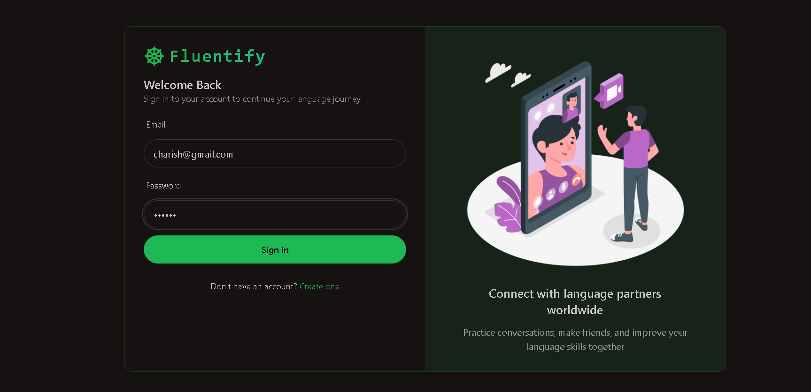
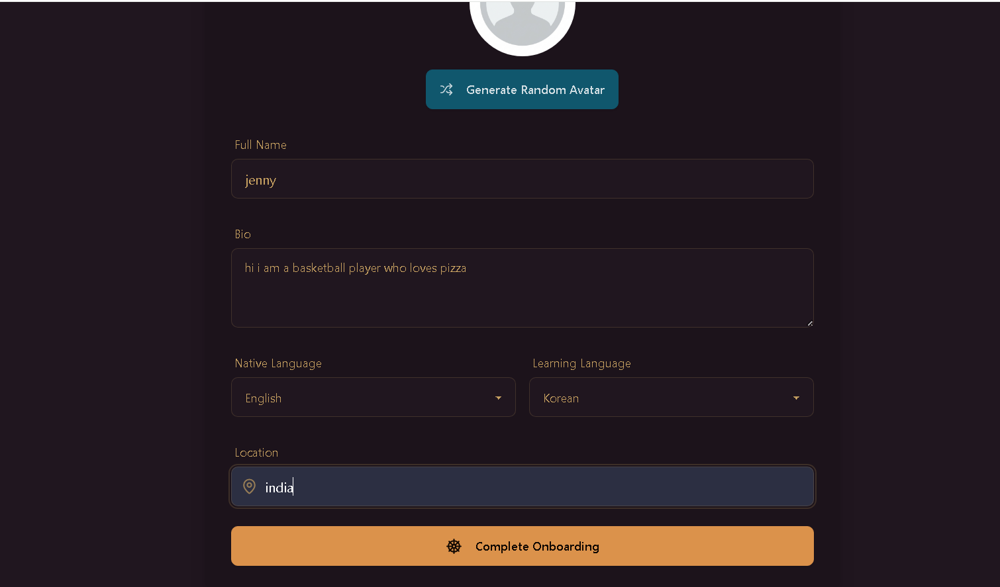
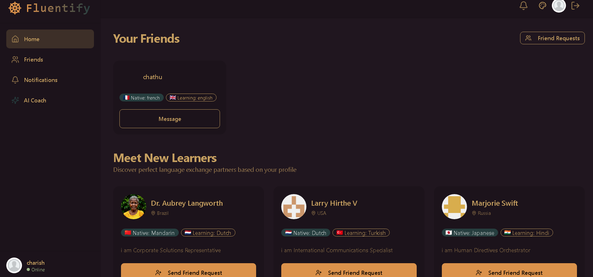
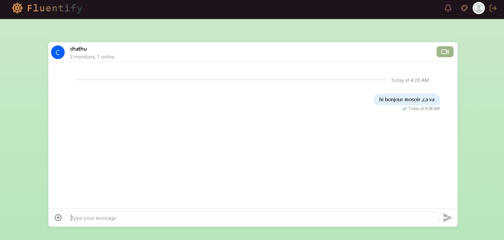
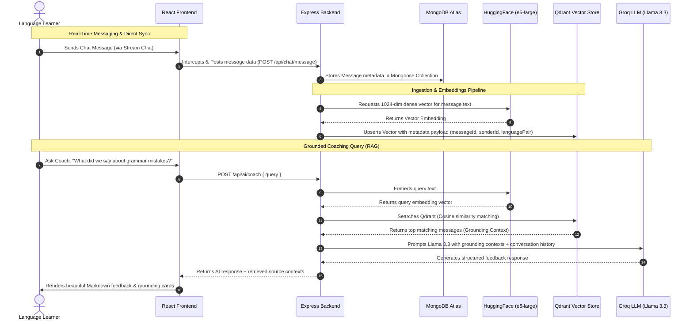

# 🚀 Fluentify (formerly Streamify)

Fluentify is a premium, state-of-the-art real-time language-learning web application that empowers users to chat, video call, and learn languages interactively. 

The application features a personalized **Retrieval-Augmented Generation (RAG) AI Language Coach** that analyzes real-time chat histories using semantic vector search to provide context-aware feedback, vocabulary corrections, and grammatical insights.

---

## 📸 Visual Tour & System Screenshots

### 1. Welcome & Authentication (Sign In / Sign Up)
Secure, modern entry portal featuring form validation, dynamic password toggling, and real-time JWT session authentication.

| Sign In Screen | Sign Up / Register Screen |
|---|---|
|  |  |

---

### 2. Onboarding Workflow
Dynamic, tailorable settings for selecting native language, target learning language, bio, and setting up profiles.


---

### 3. Dashboard (Home Page)
Glassmorphic dashboard displaying recommended language partners, active friends, online statuses, and options to send request/start call.


---

### 4. Real-Time Chat Interface
Rich chat console integrated with Stream Chat SDK, featuring instant message synchronization, WebSocket fallbacks, and customizable layouts.


---

### 5. Multi-Theme Switcher
Supported by TailwindCSS and DaisyUI, allowing users to customize their visual interface dynamically.


---

### 6. Grounded AI Coach
The personalized coach UI renders Markdown-formatted feedback, grammar tips, and copyable coding snippets, accompanied by a RAG Retrieval Memory panel showing similarity matches.


---

## 🛠️ System Architecture & Data Flow

Below is the technical data flow illustrating how messages are ingested, vector-indexed, and queried by the AI Coach.



---

## 💻 Tech Stack

### Frontend
*   **Core:** React 19, React Router v7
*   **State Management & Caching:** Zustand, TanStack React Query (v5)
*   **Design & Theme System:** TailwindCSS, DaisyUI (20+ themes supported), Lucide React Icons
*   **Integrations:** Stream Chat SDK (`stream-chat-react`), Stream Video/Call SDK (`@stream-io/video-react-sdk`)

### Backend
*   **Runtime & Server:** Node.js, Express, Nodemon
*   **Databases:** MongoDB Atlas (via Mongoose), Qdrant Vector DB (Self-hosted/Cloud)
*   **AI Pipelines:**
    *   **Embeddings Generator:** HuggingFace Inference API (`intfloat/multilingual-e5-large`)
    *   **Inference LLM:** Groq SDK (`llama-3.3-70b-versatile`)
*   **Sync Mechanisms:** MongoDB Change Streams (for replica set deployments) + Direct HTTP Ingestion Controller fallback, plus automated server-to-Stream user synchronizer.

---

## ⚙️ Configuration & Environment Setup

Ensure the following configuration parameters are defined prior to starting the applications.

### Backend Setup (`backend/.env`)
Create a `.env` file in the `backend/` directory:
```env
PORT=5001
JWT_SECRET_KEY=your_jwt_secret_key
MONGOURI=mongodb+srv://<username>:<password>@cluster.mongodb.net/fluentify
STREAM_API_KEY=your_stream_api_key
STREAM_API_SECRET=your_stream_api_secret
HUGGINGFACE_API_KEY=your_huggingface_token_here
GROQ_API_KEY=your_groq_api_key_here
```

### Frontend Setup (`frontend/.env`)
Create a `.env` file in the `frontend/` directory:
```env
VITE_STREAM_API_KEY=your_stream_api_key
```

---

## 🚀 Running the App Locally

### 1. Start the Backend
```bash
cd backend
npm install
npm run dev
```
*Expected Console Logs:*
*   `Server is running on port 5001`
*   `MongoDB connected`
*   `Successfully synced X users to Stream.`
*   `Qdrant: Collection 'messages' is ready.`
*   `MongoDB Change Stream: Successfully listening...`

### 2. Start the Frontend
```bash
cd frontend
npm install
npm run dev
```
Navigate to `http://localhost:5173` to explore the app.

---

## 🧪 Integration Testing with Postman

Since routes are protected, verify core APIs by setting up a session cookie:

1.  **Authentication:** Send a `POST` request to `http://localhost:5001/api/auth/login` containing your credentials. Postman will save the `jwt` cookie automatically.
2.  **Generate Stream Token:** Send a `GET` request to `http://localhost:5001/api/chat/token` to verify JWT signature validation and Stream communication.
3.  **Manual Message Ingestion:** Send a `POST` request to `http://localhost:5001/api/chat/message` with a JSON body representing your chat message metadata to check manual ingestion to MongoDB and Qdrant.
